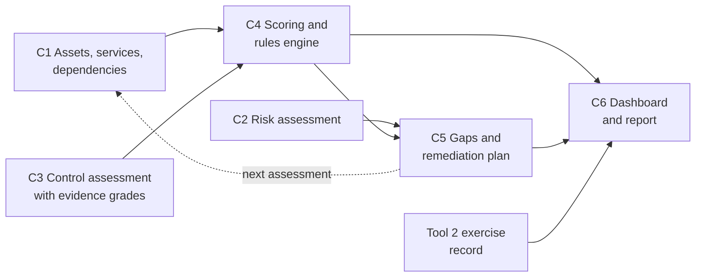

# Framework Specification

**Working name:** Service-Centred Cyber-Resilience Planning and Assessment Framework (SC-CRPAF)
**Version:** 0.1 draft for student review, 14 November 2026
**Status:** A proposed framework for an academic prototype. It has not been used in or reviewed by any bank. It is not a compliance assessment, a certification tool or a substitute for regulatory supervision.

Every rule and number below is labelled by its basis, using the convention of the existing paper: **Reg** applies an identified CBN (2024) requirement, **Std** applies published standards or guidance, **Des** is this study's own design proposal.

---

## 1. Purpose, users and scope

**Purpose.** To let a bank judge, service by service, whether recovery from a cyberattack has been *demonstrated* and not merely documented, and to produce a prioritised plan for closing the gaps.

**Users.** IT infrastructure and disaster-recovery managers and the CISO's team complete the assessment. Business service owners, operational risk, internal audit and the board risk committee read the outputs.

**Scope.** Three services in a Nigerian commercial bank: electronic payments, core banking transactions and ATM services.

---

## 2. Structure

The framework keeps the structure of the existing paper and adds an assessment layer.

| Element | Count | Source |
|---|---:|---|
| Dimensions A–E | 5 | Paper, Section 4.8.1 |
| Stages S1–S7 | 7 | Paper, Table 4.3 |
| Decision rules DR1–DR10 | 10 | Paper, Table 4.2 |
| Planning tools (Tool 1, Tool 2) | 2 | Paper, Tables 4.4 and 4.5 |
| Assessment components C1–C6 | 6 | New: master prompt Components A–F, renamed to avoid a clash with Dimensions A–E |
| Control catalogue | 30 controls, 10 domains | New: `docs/03-control-catalogue.md` |
| Readiness gates G1–G7 | 7 | New: DR1–DR6 turned into pass/fail tests, plus one dependency rule |

### 2.1 Components: inputs, rules and outputs

| Component | Stage | Inputs | Processing rules | Outputs |
|---|---|---|---|---|
| C1 Asset and service identification | S1–S3 | Services, owners, recovery requirements, assets, dependencies | DR1, DR2, DR3 | Critical services register, asset register, dependency register (Tool 1 fields) |
| C2 Risk assessment | S2–S3 | Threat scenarios per service | Section 6 | Risk register with rating per scenario |
| C3 Resilience control assessment | S4–S5 | Control catalogue, assessor's grades and evidence | Section 3 | Assessment record |
| C4 Scoring and rules engine | S5 | Outputs of C1–C3, exceptions | Sections 4 and 5 | Scores, gate results, readiness status |
| C5 Gap analysis and remediation | S7 | Outputs of C4, target grades | Section 7; DR10 | Gap list, action plan, exception register |
| C6 Reporting and decision support | S5–S7 | All of the above; Tool 2 records | Section 8 for Tool 2 | Dashboard, exported report |

Tool 2 (the safe service-resumption checklist, DR7–DR9) is used in stage S6 during a restoration exercise or after an incident. It is recorded through C6.

---

## 3. Evidence grades (Des)

Each applicable control is graded for each service. Organisation-level controls are graded once and count towards every service.

| Grade | Meaning | What must be recorded |
|---|---|---|
| 0 | Not implemented, or no information | Nothing |
| 1 | Planned or partly implemented | A description |
| 2 | Implemented by statement only | A description |
| 3 | Implemented, with evidence | A reference to an evidence artefact |
| 4 | Demonstrated by test or exercise | An evidence reference and the date of the test |

The scale applies Finding Four of the paper: documented recovery is not demonstrated recovery.

**Effective grade.** The engine never trusts a recorded grade that lacks its supporting record:

| Recorded | Condition | Effective grade |
|---|---|---|
| 3 or 4 | No evidence reference | 2 |
| 4 | Evidence reference but no test date | 3 |
| 4 | Test date older than the validity period | 3 |
| Any | Not assessed | 0, and counted as not assessed |
| Any | Marked not applicable with a written justification | Excluded |
| Any | Marked not applicable without a justification | 0, and counted as not assessed |

**Validity period (Des).** Default 365 days, configurable. DR5 leaves the period for each bank to set; the default is an assumption for the prototype.

---

## 4. Scoring (Des)

The score is a researcher-developed measure. It is **not** a NIST CSF Tier, **not** the maturity level produced by the CBN Cybersecurity Self-Assessment Tool, and not a certification result. NIST describes Tiers as characterising the rigour of risk governance and management practices, and says they should complement an organisation's methodology rather than replace it.

Let *g* be the effective grade of a control, *w* its weight, *W* a domain weight and *K* a service's criticality (1–5).

- **Control score** = *g* / 4
- **Domain score** for a service = Σ(*w* × *g*/4) ÷ Σ*w*, over the applicable controls in the domain
- **Service score** = Σ(*W* × domain score) ÷ Σ*W*, over domains with at least one applicable control
- **Overall score** = Σ(*K* × service score) ÷ Σ*K*

Scores are shown as percentages with one decimal place.

Three figures are always shown beside a score, because a single number hides too much:

1. **Coverage**: share of applicable controls that were assessed.
2. **Demonstrated share**: share of applicable controls with an effective grade of 4.
3. **Grade distribution**: number of controls at each grade.

**Control weights.** 2 where the control is itself a condition of a readiness gate or of the resumption decision (DR7–DR9); otherwise 1. Twelve controls carry weight 2.

**Target grades.** 4 for the six controls that are tests or exercises; 3 for the rest. Because most targets are 3, a bank that meets every target scores below 100%. A score of 100% would mean every control had been demonstrated by test.

**Weighting schemes for sensitivity analysis**

| Scheme | Control weight | Domain weight | Service weight |
|---|---|---|---|
| A Baseline | 1 or 2 as catalogued | 1 | Criticality |
| B Equal | 1 | 1 | 1 |
| C Recovery emphasis | As A | 2 for BKP, BCP, RED and INC; 1 for the rest | Criticality |

The report shows scores and the ranking of services under all three schemes. Gate results do not depend on weights, so readiness status is identical under every scheme. That is a deliberate design property and the tests check it.

---

## 5. Readiness gates and status

A gate is a pass/fail test. A high score cannot compensate for a failed gate.

| Gate | Rule | Test applied by the engine | Basis | Can an approved exception waive it? |
|---|---|---|---|---|
| G1 | DR1 | The service has a named business owner and a named technical owner | Reg+Des | No |
| G2 | DR2 | Maximum tolerable downtime, RTO and RPO are recorded and marked approved, RTO does not exceed the maximum tolerable downtime, and BCP-01 has an effective grade of at least 3 | Std+Des | No |
| G3 | DR3 | No dependency of the service is unresolved. A dependency is unresolved if it is a single point of failure with no tested alternative, or a third-party dependency with no tested recovery coordination | Reg+Des | Yes, per dependency |
| G4 | DR4 | ACC-02, ACC-03 and ACC-04 each have an effective grade of at least 3 | Reg+Des | ACC-03 only, with a compensating control |
| G5 | DR5 | BKP-01 at least 3, BKP-02 equal to 4, BKP-03 at least 3 | Reg+Std+Des | No |
| G6 | DR6 | BCP-02 at least 3, BCP-03 equal to 4, INC-02 at least 3 | Reg+Des | No |
| G7 | New | No service that this service depends on is "Not demonstrated" on its own gates G1–G6, followed transitively | Des (Finding Two) | No |

A gating control marked not applicable with a justification satisfies its condition. A gating control that was not assessed, or that is missing from the catalogue in use, fails it.

**Waivers.** DR3 and DR4(b) of the paper allow a documented risk acceptance or a compensating control. A gate passes "with exception" only if an exception record exists that is linked to the specific dependency or to ACC-03, is approved, is still open and has not passed its due date.

**Readiness status of a service**

| Status | Condition |
|---|---|
| Ready | Every gate passes |
| Ready with accepted exceptions | Every gate passes, at least one by exception |
| Not demonstrated | Any gate fails |

The paper's DR6 uses "ready" and "not demonstrated". The middle status is added so that an accepted risk stays visible.

---

## 6. Risk assessment (Des)

Each threat scenario is recorded against a service with a likelihood and an impact, both on a 1–5 scale.

| Value | Likelihood (assessor's judgement) | Impact on the service |
|---|---|---|
| 1 | Rare | Negligible: no customer effect |
| 2 | Unlikely | Minor: brief degradation |
| 3 | Possible | Moderate: outage within the maximum tolerable downtime |
| 4 | Likely | Major: outage beyond it, or loss of data integrity in part |
| 5 | Almost certain | Severe: prolonged outage or untrustworthy records |

**Rating** = likelihood × impact. Bands: Low 1–4, Medium 5–9, High 10–14, Critical 15–25.

Each scenario also records whether it could affect the **recovery environment**. That flag is the difference between a cyber-resilience assessment and an ordinary continuity assessment.

**Limits.** The scales are ordinal and the anchors are the researcher's. No frequency data for Nigerian banks was used, because none was found in the sources reviewed. Multiplying ordinal scores is a known weakness of risk matrices. The rating is used only to order remediation actions.

---

## 7. Gap analysis and remediation (Des)

**Gap** = target grade − effective grade, where positive.

**Action wording** depends on the current grade:

| Effective grade | Action type |
|---|---|
| 0 or 1 | Implement |
| 2 | Record evidence |
| 3, where the target is 4 | Test and record the result |

Actions are also raised for a missing owner (G1), missing or unapproved recovery requirements (G2), an unresolved dependency (G3) and a dependency on a service that is not ready (G7).

**Priority tier**

| Tier | Rule |
|---|---|
| P1 | The item is a condition of a failed gate |
| P2 | Any other gap where the control weight is 2 or the gap is 2 or more |
| P3 | Remaining gaps |

**Order within a tier:** gap × control weight × service criticality × risk factor, highest first; ties are broken by service identifier and then control identifier so that the order is always the same.

Actions that are not control gaps (a missing owner, missing recovery requirements, an unresolved dependency, a service depended on that is not ready) have no grade gap. They are given the largest gap (4) and weight (2) so that they sort first within P1. An organisation-level control gap is listed once, using the highest service criticality and the highest risk factor.

**Risk factor** = 1 + (highest risk rating recorded for the service ÷ 25). If no risk has been recorded for the service, the factor is 2.0 and the report says so. Missing information is treated as the worst case, in the same way as missing evidence.

Every action shows the service, control, current and target grade, the gate or rule it relates to, and the evidence expected. This is what makes the plan traceable.

**Exception register (DR10).** Each exception records the service, the rule or gate, the dependency or control it relates to, a description, owner, treatment (remediation or risk acceptance), compensating control, approver, due date, status and closure evidence. An exception cannot be closed without closure evidence. An open exception past its due date is flagged as overdue and no longer waives a gate.

---

## 8. Resumption decision: Tool 2 (DR7–DR9)

Tool 2 is the 13-check checklist of the paper's Table 4.5. Each check is answered Yes, No or Not applicable, with an evidence reference.

| Decision | Condition |
|---|---|
| Resume | Every applicable check is Yes |
| Resume conditionally | The only No answers are reconciliation checks (4.1–4.3); checks 5.1, 5.2 and 6.1 are Yes; and at least one condition is recorded, each with an owner and an expiry date |
| Withhold | Anything else, including any unanswered check |

Not applicable is accepted only for a reconciliation check of a service outside the scope of the exercise. Technical restoration alone never produces "Resume".

---

## 9. Assessment procedure

1. Register the services, owners and criticality (S1).
2. Record the approved recovery requirements for each service (S2).
3. Register assets and dependencies, including third parties (S3).
4. Record threat scenarios and rate them (S2–S3).
5. Grade each control and record the evidence (S4–S5).
6. Record any exceptions and their approval.
7. Run the engine: scores, gates and readiness status.
8. Review gaps and the action plan; record a Tool 2 checklist for any restoration exercise (S6).
9. Export the report. Repeat after remediation or significant change (S7).

---

## 10. What reading the sources changed

These points came out of reading the CBN (2024) framework and NIST CSF 2.0 in full on 14 November 2026. They affect the manuscript.

1. **Every CBN section reference in the existing paper was confirmed** against the framework text, including the issue date, compliance date and letter reference.
2. **The CBN text read contains no explicit requirement for network segmentation, for recovery time or recovery point objectives, or for redundancy inside a bank.** Section 3.7 addresses single points of failure in the industry. Controls in those areas are therefore labelled Std or Des, not Reg. This supports the paper's own argument about what the regulation leaves unspecified.
3. **The CBN framework has its own maturity assessment** (Section 2.4, using the Cybersecurity Self-Assessment Tool, with a current and a target profile). The manuscript must distinguish this framework's score from it.
4. **The CBN framework's informative references cite COBIT 5**, not COBIT 2019 (Appendix V).
5. **NIST CSF 2.0 asks to be cited with NIST as the author.** The existing paper cites it as Pascoe et al. (2024). This should be resolved when the references are checked.

---

## 11. Limitations

1. **No validation.** The grades, weights, targets, gates and priority rule are design assumptions. Nobody outside the study has reviewed them.
2. **Self-declared inputs.** The framework raises the bar for evidence but still depends on what the assessor records. It checks that evidence is referenced and dated, not that it is true.
3. **Uneven depth of sources.** The CBN and NIST texts were read in full. ISO and COBIT are mapped by identifier and short title only, from secondary sources; ten references remain unverified and are marked in the catalogue.
4. **Ordinal arithmetic.** Averaging grades and multiplying risk scales treats ordinal values as numbers. The gates, the grade distribution and the sensitivity analysis are there to limit the harm.
5. **Simplified dependencies.** Dependencies are recorded between services and from services to assets. Real dependencies can be circular and time-dependent.
6. **Synthetic demonstration only.** Results from the fictional bank show that the method works as specified. They say nothing about any real bank.

---

## 12. Implemented in the seminar prototype or left for later

| Element | Seminar prototype | Later |
|---|---|---|
| C1–C6, evidence grades, scoring, gates G1–G7, gap and priority rules | Yes | |
| Exception register with waiver logic | Yes | |
| Tool 2 checklist and resumption decision | Yes | |
| Tool 1 as a per-service report view | Yes | |
| Three weighting schemes | Yes | |
| Editing the control catalogue inside the application | | Yes; in the prototype it is a versioned file |
| Automated evidence collection (for example from Intune or Entra ID) | | Yes |
| Historical trend across assessments | | Yes |
| Multiple organisations, user roles and login | | Yes |
| Expert review and field evaluation | | Yes |
